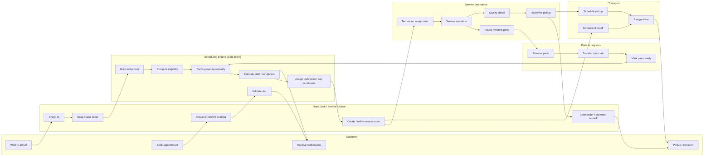
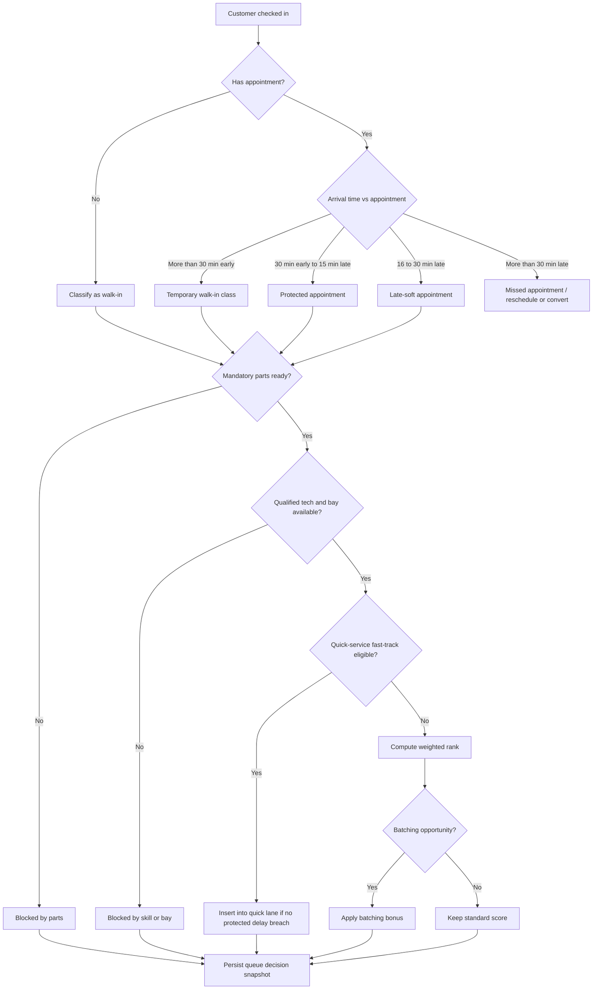
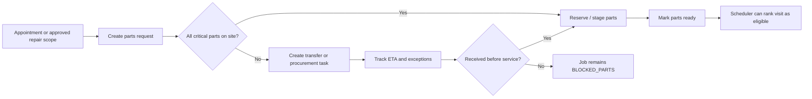
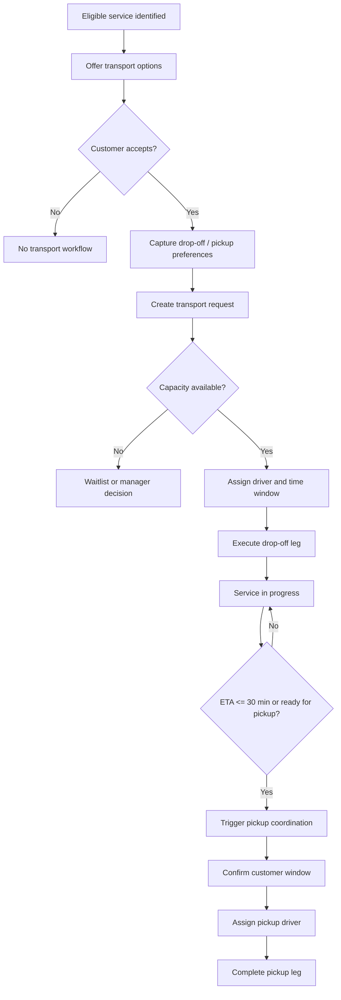
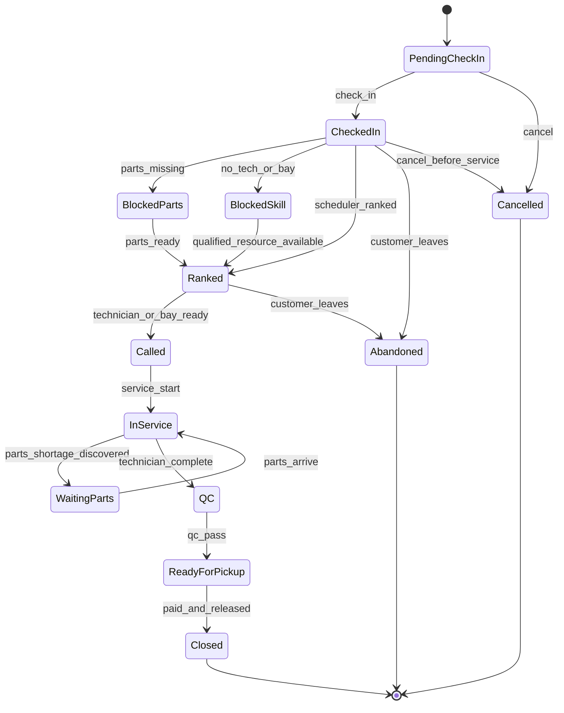

# 02_Process_Flows.md

## Purpose

This document provides the first-pass process diagrams for the unified platform.

Use these flows before any UI or schema build.
If Claude proposes logic that contradicts these flows, it must explain why and submit a review request.

---

## 1. End-to-End Service Journey

Source file: `diagrams/01_service_journey.mmd`

---

## 2. Queue Priority and Eligibility Flow

Source file: `diagrams/02_queue_priority_logic.mmd`

### Flow notes
- Check-in is the activation trigger for queue participation.
- Appointment timing determines protection class.
- Parts and resource constraints can block otherwise valid visits.
- Quick-service insertion is conditional, not automatic.
- Every ranking decision should be explainable.

---

## 3. Parts Reservation and Transfer Flow

Source file: `diagrams/03_parts_logistics_flow.mmd`

### Flow notes
- Parts readiness must be visible before the day is lost.
- Next-day appointments should be reviewed by a cutoff.
- Jobs blocked by parts remain visible to staff, not hidden.

---

## 4. Transport Coordination Flow

Source file: `diagrams/04_transport_flow.mmd`

### Flow notes
- Transport is governed by eligibility and capacity.
- Customer confirmation must exist before final driver assignment.
- Pickup orchestration should start before actual completion, using ETA.

---

## 5. Scheduler State Machine

Source file: `diagrams/06_scheduler_state_machine.mmd`

### State design notes
- `BlockedParts` and `BlockedSkill` are explicit states, not vague notes.
- `Ranked` is separate from `Called` so the board can show waiting vs ready.
- `WaitingParts` during service must preserve actual operational delay data.

---

## 6. Process Design Rules

1. Every process must have a clear system trigger.
2. Every handoff should produce a state change or timestamp.
3. Failure states must be modeled explicitly.
4. Customer-facing status must come from real operational state, not manual guesswork.
5. Manager intervention must be visible in process history.

---

## 7. Diagram Governance

When updating a flow:
- update the diagram file
- update the related rules
- update any impacted entity statuses
- check if tests or UX states also change

No flow changes should happen in isolation.
