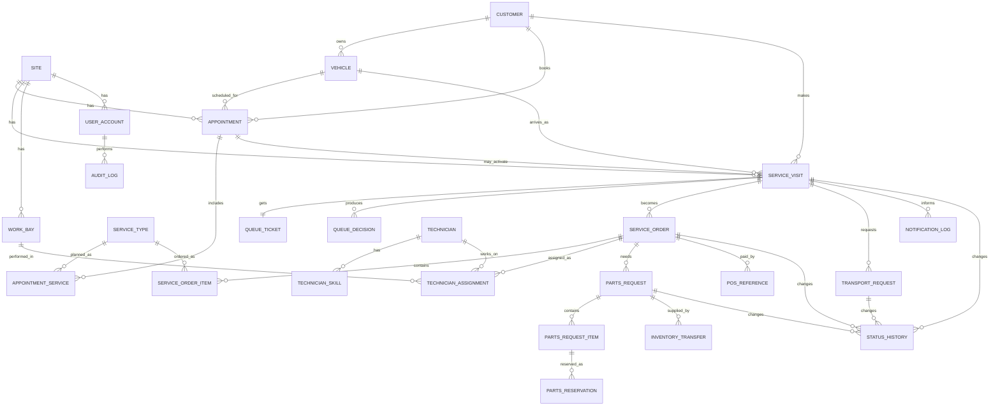

# 09_Data_Model.md

## Purpose

This document defines the shared data model for the unified platform.

The most important rule:
> **If two modules need the same truth, store it once.**

The SQL starter blueprint is in:
- `db/schema_outline.sql`

The ERD source is in:
- `diagrams/05_domain_erd.mmd`

---

## 1. Core Entity Inventory

| entity | purpose | key_fields |
| --- | --- | --- |
| Site | Operational location / branch / service centre. | id, code, name, timezone, status |
| UserAccount | Authenticated staff identity and site membership. | id, auth_subject, role, site_id, status |
| Customer | Person or account receiving service. | id, customer_number, name, phone, email, communication_preferences |
| Vehicle | Customer vehicle master record. | id, customer_id, plate_number, vin, make, model, year |
| ServiceType | Catalog-driven service definition. | id, code, family, base_duration, skill_code, bay_type |
| Appointment | Planned future service booking. | id, site_id, customer_id, vehicle_id, scheduled_start_at, status |
| AppointmentService | Requested services linked to an appointment. | id, appointment_id, service_type_id, qty |
| ServiceVisit | Canonical operational visit activated at arrival or created as walk-in. | id, appointment_id?, source_type, arrival_at, checked_in_at, status |
| QueueTicket | Immutable queue reference and current display state. | id, service_visit_id, ticket_number, checkin_sequence, queue_rank |
| QueueDecision | Explainable scheduler snapshot for a visit. | id, service_visit_id, priority_class, score, reasons_json, blocked_reason |
| ServiceOrder | Advisor-approved operational job card. | id, service_visit_id, status, promised_completion_at, payment_status |
| ServiceOrderItem | Line-level work and estimate tracking. | id, service_order_id, service_type_id, estimate_minutes, actual_minutes, status |
| Technician | Workshop resource person. | id, user_account_id, employee_code, status |
| TechnicianSkill | Technician capability map. | id, technician_id, skill_code, proficiency_level |
| WorkBay | Physical service station / bay. | id, site_id, code, bay_type, status |
| TechnicianAssignment | Which technician and bay worked on which order. | id, service_order_id, technician_id, bay_id, assigned_at, started_at, ended_at |
| PartsRequest | Job-level parts requirement object. | id, service_order_id, status, required_by_at |
| PartsRequestItem | Individual SKU/quantity line item. | id, parts_request_id, sku, qty_requested, qty_reserved, critical_flag, status |
| PartsReservation | Reservation record at inventory source. | id, parts_request_item_id, inventory_location_code, status |
| InventoryTransfer | Parts movement between locations. | id, parts_request_id, source_site_id, destination_site_id, eta_at, received_at, status |
| TransportRequest | Customer or vehicle transport workflow. | id, service_visit_id, direction, scheduled_at, status, driver_user_id |
| NotificationLog | Message scheduling and delivery tracking. | id, entity_type, entity_id, channel, template_key, status, scheduled_at, sent_at |
| POSReference | Link to external payment / invoice record. | id, service_order_id, external_ref, amount, status |
| StatusHistory | Timestamped lifecycle changes. | id, entity_type, entity_id, from_status, to_status, changed_at, reason_code |
| AuditLog | Actor-centric audit for privileged actions and edits. | id, actor_user_id, action, entity_type, entity_id, before_json, after_json |
| BusinessRuleConfig | Configurable rule values and templates. | id, rule_key, value_json, effective_from, effective_to, site_id? |

---

## 2. Canonical Aggregate Pattern

### 2.1 Appointment is planning truth
An appointment represents a planned visit:
- time
- customer
- vehicle
- requested services
- confirmation

### 2.2 ServiceVisit is operational truth
A service visit represents what is actually happening operationally:
- arrival
- check-in
- queue participation
- active lifecycle
- transport context
- workshop context

### 2.3 ServiceOrder is execution truth
A service order represents the approved work to be executed and billed.

These three things must stay distinct.

---

## 3. Core Relationship Rules

1. A `Customer` can own many `Vehicles`.
2. A `Customer` can have many `Appointments`.
3. An `Appointment` can contain many `AppointmentServices`.
4. A `ServiceVisit` may come from an `Appointment`, but it can also be walk-in-only.
5. A `ServiceVisit` has one active `QueueTicket`.
6. A `ServiceVisit` can produce one or more `QueueDecision` snapshots over time.
7. A `ServiceVisit` may create one primary `ServiceOrder`, with multiple `ServiceOrderItems`.
8. A `ServiceOrder` can have many `TechnicianAssignments`.
9. A `ServiceOrder` can have one or more `PartsRequests`.
10. A `ServiceVisit` can have zero or more `TransportRequests`.
11. Operational entities should write to `StatusHistory`.
12. Sensitive actions should also write to `AuditLog`.

---

## 4. Entity Ownership by Module

| Entity | Owning module | Notes |
| --- | --- | --- |
| Appointment | Scheduling Engine | Planning and time-slot truth |
| ServiceVisit | Intake & Queue / Scheduling Engine | Canonical operational visit |
| QueueTicket | Intake & Queue | Immutable operational reference |
| QueueDecision | Scheduling Engine | Explainable decision snapshots |
| ServiceOrder | Service Operations | Workshop execution |
| PartsRequest | Parts & Logistics | Inventory dependency truth |
| TransportRequest | Transport | Convenience and dispatch flow |
| BusinessRuleConfig | Governance | Configurable policy state |

Owning module does **not** mean isolated storage.
It means clear responsibility for state transitions.

---

## 5. Status Models

| entity | status_flow |
| --- | --- |
| Appointment | DRAFT -> CONFIRMED -> CHECKED_IN -> IN_PROGRESS -> COMPLETED; or CANCELLED / MISSED / RESCHEDULED |
| ServiceVisit | CREATED -> ARRIVED -> CHECKED_IN -> QUEUED -> CALLED -> IN_SERVICE -> WAITING_PARTS -> QC -> READY_FOR_PICKUP -> CLOSED; or ABANDONED / CANCELLED |
| QueueTicket | ISSUED -> WAITING -> CALLED -> IN_SERVICE -> BLOCKED -> COMPLETED; or CANCELLED |
| ServiceOrder | DRAFT -> APPROVED -> ASSIGNED -> IN_PROGRESS -> WAITING_PARTS -> QC -> READY_TO_INVOICE -> CLOSED |
| PartsRequest | OPEN -> RESERVING -> PARTIAL -> READY -> TRANSFER_IN_PROGRESS -> RECEIVED -> CLOSED; or CANCELLED |
| InventoryTransfer | REQUESTED -> APPROVED -> IN_TRANSIT -> RECEIVED; or DELAYED / CANCELLED |
| TransportRequest | REQUESTED -> CONFIRMATION_PENDING -> SCHEDULED -> DRIVER_ASSIGNED -> IN_PROGRESS -> COMPLETED; or CANCELLED |

### Status design rules
- use explicit states, not vague booleans
- prefer lifecycle states over hard deletes
- write state transitions to status history
- prevent impossible transitions through service logic

---

## 6. Required Unique Constraints

Recommended examples:
- `customer.customer_number` unique
- `vehicle.vin` unique when available
- `vehicle.plate_number + site` unique or globally unique per policy
- `queue_ticket.ticket_number` unique
- one active queue ticket per active service visit
- one active service visit per customer + vehicle + site + day unless special exception
- one active technician assignment per technician at the same moment unless paused state permits exception
- one business rule config version active for the same rule and site at the same effective time

---

## 7. Audit and Temporal Requirements

### Required timestamps
At minimum capture:
- appointment created / confirmed / rescheduled / cancelled
- arrival time
- check-in start and completion
- queue rank recompute time
- service start
- service pause
- waiting parts start / end
- QC completion
- ready for pickup
- payment confirmation
- vehicle release / close
- parts request / reserve / transfer / receive
- transport request / schedule / start / complete

### Required history tables
- `StatusHistory`
- `AuditLog`

These are not optional if reporting and accountability matter.

---

## 8. Multi-Site Readiness

Even if pilot is one location:
- every operational entity should carry `site_id` where appropriate
- inventory transfer must support source and destination site
- user access should be site-aware
- reporting should be filterable by site

Do not design single-site shortcuts into the schema.

---

## 9. Privacy and Display Rules

- customer-facing queue board should not show raw PII
- internal records can store customer details with proper RBAC
- communications preferences and consent should be stored on customer record or linked preference entity
- soft-delete or anonymization policy must be possible for privacy requests

---

## 10. Derived Views / Read Models That Are Safe

It is acceptable to create projections such as:
- live queue board view
- manager operations dashboard view
- technician “my queue” view
- next-day parts board
- transport dispatch board

But those must read from canonical entities, not become competing sources of truth.

---

## 11. Anti-Patterns to Avoid

- separate queue database and scheduling database
- appointment status copied into multiple tables as independent truths
- storing queue rank as the ticket number itself
- technician availability inferred from UI only
- parts readiness kept only in comments or notes
- service completion without timestamps
- manual override with no reason code

---

## 12. ERD

---

## 13. Implementation Guidance

### Prefer
- normalized write model
- clear foreign keys
- enums or constrained status values
- append-only history patterns for audit
- careful indexing around site/date/status/rank

### Avoid
- early denormalized shortcuts
- magic JSON as the only place business data lives
- hidden state transitions in triggers without service-layer documentation

---

## 14. Linked Files

- `db/schema_outline.sql`
- `docs/08_Scheduling_Engine_Spec.md`
- `docs/11_API_Contracts_Integrations.md`
- `docs/15_Security_Governance.md`
